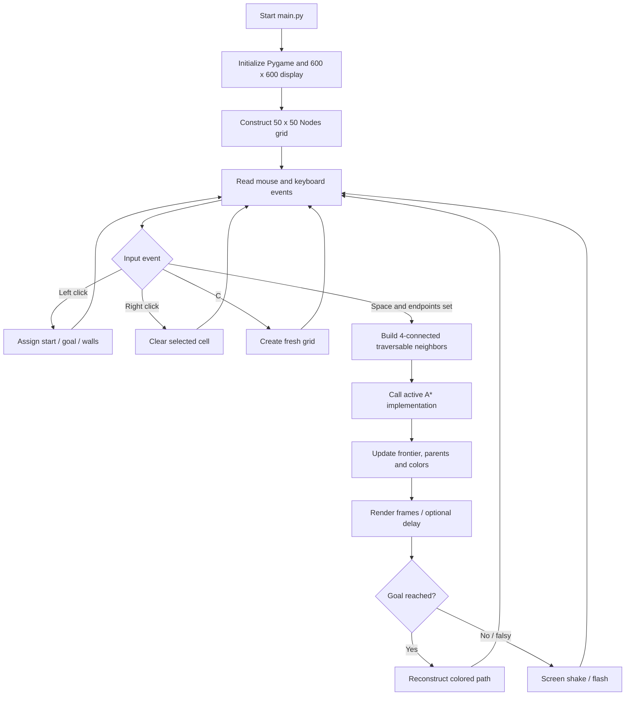

<div align="center">

# Algorithmic Hub

### An Interactive Laboratory for Classical Graph Search and Grid-Based Pathfinding

**Visualize search frontiers, examine algorithmic trade-offs, and study how different strategies explore the same discrete state space.**

[](https://www.python.org/)
[](https://www.pygame.org/)
[](#algorithm-catalogue)
[](LICENSE)
[](#project-status-and-scope)

[Quick Start](#quick-start) · [Algorithms](#algorithm-catalogue) · [Methodology](#problem-formulation) · [Architecture](#architecture-and-execution-model) · [Limitations](#known-limitations-and-technical-debt) · [Contributing](#contributing)


[**Watch the demonstration**](https://youtu.be/eTAAgStW5zE)

</div>

## Contents

1. [Overview and objectives](#overview-and-objectives)
2. [Project status and scope](#project-status-and-scope)
3. [Features and interaction model](#features-and-interaction-model)
4. [Quick start](#quick-start)
5. [Repository structure](#repository-structure)
6. [Architecture and execution model](#architecture-and-execution-model)
7. [Problem formulation](#problem-formulation)
8. [Algorithm catalogue](#algorithm-catalogue)
9. [Algorithm design and implementation notes](#algorithm-design-and-implementation-notes)
10. [Data structures and state transitions](#data-structures-and-state-transitions)
11. [Complexity and theoretical comparison](#complexity-and-theoretical-comparison)
12. [Correctness, reproducibility and evaluation](#correctness-reproducibility-and-evaluation)
13. [Known limitations and technical debt](#known-limitations-and-technical-debt)
14. [Development roadmap](#development-roadmap)
15. [Contributing](#contributing)
16. [Research references](#research-references)
17. [License](#license)

## Overview and objectives

**Algorithmic Hub** is a Python/Pygame desktop visualization project for studying graph-search and pathfinding strategies on a user-defined, obstacle-constrained grid. Users create a start state, a goal state, and impassable cells. The visualizer then renders a search procedure as it explores candidate states and, if a route is identified, highlights a reconstructed path.

The project makes the mechanics of search observable: **frontier expansion, explored-state marking, parent tracking, heuristic guidance, and differences in traversal order**. Rather than treating a shortest-path procedure as a black box, the code exposes its queue/stack operations, neighbor generation, state updates, and rendering in Python.

### Intended learning outcomes

| Objective | Question investigated | Relevant mechanism |
|---|---|---|
| Graph modeling | How is a 2D environment transformed into a finite state graph? | `Nodes`, `make_grid`, `update_neighbours` |
| Uninformed search | How do FIFO and LIFO frontiers change exploration? | BFS, DFS |
| Heuristic search | How does an estimate of remaining distance guide expansion? | A*, Greedy Best-First Search |
| Cost-sensitive search | What changes when frontier priority depends on accumulated cost? | UCS, Dijkstra |
| Depth constraints | What happens when search is limited to depth `L`? | DLS, iterative deepening |
| Two-direction search | Can searching from both endpoints reduce the explored region? | Bidirectional BFS |
| Explainability | Can the search process be observed and reasoned about step by step? | Pygame node colors and redraw callbacks |
| Verification | Do observed paths satisfy feasibility, optimality, and reproducibility criteria? | Proposed test/benchmark protocol below; **not yet automated** |

**Positioning:** This is an implementation and visualization of established algorithms, **not a claim of a novel search algorithm, a formally verified implementation, or a completed experimental research study**. Its research value lies in the comparative framework it can support once the correctness and instrumentation work described below is completed.

## Project status and scope

The following distinction is important for prospective users and contributors.

| Capability | Current state | Evidence / qualification |
|---|---|---|
| Interactive obstacle-grid editor | **Implemented** | Left/right mouse input in `main.py` |
| Start and goal selection | **Implemented** | Two-stage left-click logic in `main.py` |
| A* visualization | **Default active path** | The uncommented `a_star_algorithm(...)` call |
| Nine search function implementations | **Present in source** | Nine named implementations in `main.py` |
| Algorithm selection in the live visualizer | **Not integrated** | Other solver calls are commented out; `dashboard.py` is independent |
| Algorithm dropdown demonstration | **Standalone prototype** | Selection changes dashboard text, not the search engine |
| Animated frontier and path coloring | **Implemented, with caveats** | State is encoded in mutable node colors |
| Configurable grid size and delay | **Source-level only** | `rows`, `width`, and `speed` constants |
| Weighted terrain / diagonal movement | **Not implemented** | Four orthogonal neighbors, unit step cost |
| Automated unit / property tests | **Not present** | No test suite in the repository tree inspected |
| Performance benchmarks / published results | **Not present** | No measurement harness or experiment data |
| Reproducible GUI dependency lock | **Not present** | Poetry declares Flask but not Pygame |
| Deployable pathfinding web service | **Not implemented** | `app.py` is an unrelated Flask greeting endpoint |

### Appropriate use cases

- Learning or teaching classical search strategies and pathfinding fundamentals.
- Exploring how obstacle arrangement affects frontier expansion and route selection.
- Extending a visual prototype into a controlled algorithm-comparison framework.
- Experimenting with alternative heuristics, graph representations, and instrumentation.

The project should **not currently be relied upon** for safety-critical navigation, production routing, benchmark claims, or correctness-sensitive downstream decisions without substantial testing and refactoring.

## Features and interaction model

### What the running visualizer does

1. Creates a **50 × 50** grid by default in a **600 × 600 pixel** Pygame window.
2. Maps cursor coordinates to individual cells.
3. Accepts a start node, a goal node, and walls.
4. Computes traversable orthogonal neighbor relationships when search begins.
5. Runs the configured solver (A* in the committed default configuration).
6. Redraws cells to expose the search frontier and explored states.
7. Reconstructs a route using predecessor relationships when available.
8. Triggers a screen-shake/flash effect on the main solver's falsy result.
9. Allows the grid to be cleared and a new problem to be drawn.

### Controls

| Input | Behavior | Notes |
|---|---|---|
| Left mouse click / drag | Choose start, choose goal, then draw walls | First two suitable cells become start/goal; subsequent cells become obstacles |
| Right mouse click / drag | Reset a cell | Also clears start/goal references when those cells are selected |
| `Space` | Run the active solver | Requires start and goal; **A*** is active by default |
| `C` | Create a fresh grid | Clears obstacles, color states, start and goal |
| Close window | Exit main event loop | Pygame processes quit events in the GUI |

### Visualization legend

| Appearance | Source constant / method | Interpretation |
|---|---|---|
| White | `clr.WHITE` | Unmarked cell |
| Orange | `make_start()` | Start cell at initialization |
| Purple | `make_goal()` / `make_path()` | Goal **and** reconstructed route (same color) |
| Black | `make_wall()` | Impassable cell |
| Lime | `make_open()` | Discovered/frontier cell |
| Red | `make_closed()` | Explored/closed cell |

> [!NOTE]
> The current implementation stores visualization state **directly in the node's color field**. It does not maintain a clean separation between logical state and presentation. In particular, start/goal markers may be overwritten by subsequent search coloring; `is_goal()` checks for turquoise although `make_goal()` assigns purple. Do not infer precise solver invariants from color alone.

### Existing media

The repository's original README includes screenshots and a demonstration. These are retained as historical visual references, not evidence of current test coverage or feature integration.

<details>
<summary>Additional project screenshots</summary>


</details>

## Quick start

### Prerequisites

- **Python 3.10 or newer** (the project's Poetry metadata specifies Python `^3.10`).
- `pip` and an available Python virtual environment.
- A local graphical desktop/session capable of opening a Pygame window.
- The **Pygame** package, installed manually as shown below.

> **Dependency clarification:** There is currently **no `requirements.txt`**. The committed `pyproject.toml` specifies Flask for a separate prototype but **does not include Pygame**. Accordingly, `pip install -r requirements.txt` is not a valid installation command for this revision, and a bare `poetry install` is not sufficient for the GUI.

### macOS / Linux

```bash
git clone https://github.com/SaadARazzaq/algorithmic-hub.git
cd algorithmic-hub

python3 -m venv .venv
source .venv/bin/activate
python -m pip install --upgrade pip
python -m pip install pygame

python main.py
```

### Windows (PowerShell)

```powershell
git clone https://github.com/SaadARazzaq/algorithmic-hub.git
cd algorithmic-hub

py -3 -m venv .venv
.\.venv\Scripts\Activate.ps1
python -m pip install --upgrade pip
python -m pip install pygame

python main.py
```

If the shell blocks activation, use the virtual environment's Python executable directly rather than changing execution policy globally.

```powershell
.\.venv\Scripts\python.exe -m pip install pygame
.\.venv\Scripts\python.exe main.py
```

**Compatibility note:** These are source-derived installation instructions, not a claim that every OS/Python/Pygame combination has been exercised in automated CI. A desktop graphics environment is required; headless servers generally will not display the interface without additional configuration.

### First run

1. Run `python main.py`.
2. Left-click a cell to select the **start**.
3. Left-click a different cell to select the **goal**.
4. Left-click/drag through other cells to introduce **walls**.
5. Press **Space** to run **A***.
6. Press **C** to reset the grid for another experiment.

### Running a different algorithm — current source-level procedure

The committed `main.py` event loop has one active call and eight commented alternatives. To use a different algorithm, edit the block within the `Space` key handler: **comment out A*** and **uncomment exactly one** alternative. For example, to run BFS:

```python
# Existing active invocation — comment this out:
# path = a_star_algorithm(lambda: draw(console_window, grid, rows, width), grid, start, end, speed)

# Activate this existing invocation:
path = breadth_first(
    lambda: draw(console_window, grid, rows, width),
    grid,
    start,
    end,
    speed,
)
```

This snippet illustrates a **manual source edit**, not a runtime dropdown or a complete patch. The actual function calls already appear in the source, commented out. Some algorithms need additional arguments (e.g., the depth limit for DLS). Several implementations also have correctness or termination caveats explained below; changing the active call does **not** imply that every option will behave correctly on every maze.

### Optional standalone programs

| Command | What it runs | What it **does not** do |
|---|---|---|
| `python main.py` | Desktop grid editor and hardcoded active search | Does not show the dropdown from `dashboard.py` |
| `python dashboard.py` | Separate Pygame algorithm-choice UI mockup | Does not execute the selected algorithm or modify `main.py` |
| `python app.py` | Minimal Flask greeting app | Does not serve the visualization or expose a pathfinding API |

The `.replit` configuration invokes `python app.py`; that default starts the **Flask greeting**, not Algorithmic Hub's Pygame visualizer. To run the actual project, use `python main.py` in a suitable desktop environment.

### Source-level configuration

| Parameter | Current default | File / scope | Effect |
|---|---:|---|---|
| `width` | `600` | `main.py`, module scope | Square window dimension, in pixels |
| `rows` | `50` | `main.py`, `main()` | Creates `50 × 50 = 2,500` nodes |
| `speed` | `0` | `main.py`, module scope | Sleep interval passed to animation routines |
| `depth_limit` | `100` | `main.py`, event loop | Available when the DLS call is manually activated |
| Window flags | `pg.NOFRAME` | `main.py`, module scope | Requests a borderless Pygame window |

The cell size is calculated with integer division: `gap = width // rows`. For this default configuration, the cell width is **12 pixels**. Increasing grid resolution also increases search-state count and full-screen redraw work.

## Repository structure

```text
algorithmic-hub/
├── .gitignore            # Python-related ignore rules
├── .replit               # Replit entry point; launches Flask app.py
├── LICENSE               # MIT license (2023)
├── README.md             # Project documentation
├── app.py                # Independent Flask greeting prototype
├── colors.py             # Named RGB color constants
├── dashboard.py          # Independent Pygame selector prototype
├── finish.png            # Committed image asset
├── main.py               # Grid model, search implementations, and live GUI
├── poetry.lock           # Poetry lock for Flask-oriented environment
├── pyproject.toml        # Poetry metadata (Pygame currently undeclared)
├── replit.nix            # Replit/Nix development dependencies
├── start.png             # Committed image asset
├── vibrant_colors.py     # Additional RGB constants
└── __pycache__/          # Compiled bytecode currently tracked in the repo
```

### Responsibility map

| File / module | Responsibility | Architectural observation |
|---|---|---|
| [`main.py`](main.py) | Search algorithms, GUI loop, graph topology, visual updates | Core concerns are coupled in a single module; executing it starts the GUI unconditionally |
| [`colors.py`](colors.py) | Search visualization palette | Constants only; imported as `clr` |
| [`vibrant_colors.py`](vibrant_colors.py) | Alternative palette | Imported in `main.py`, but no current rendering integration was identified |
| [`dashboard.py`](dashboard.py) | List of nine algorithms, dropdown, placeholder instruction button | Separate event loop; no command dispatch into `main.py` |
| [`app.py`](app.py) | Flask `/` endpoint returning greeting HTML | Separate prototype, not part of the search pipeline |
| [`pyproject.toml`](pyproject.toml) / [`poetry.lock`](poetry.lock) | Python packaging/dependency metadata | Tracks Flask, not GUI runtime dependencies |
| [`.replit`](.replit) / [`replit.nix`](replit.nix) | Replit runtime configuration | Default command points at `app.py` |
| [`LICENSE`](LICENSE) | Open-source licensing | MIT |

## Architecture and execution model

The main interactive program currently follows this path:



The `dashboard.py` and `app.py` programs are **not** edges in this runtime graph: each contains its own entry point and does not control the active search.

### Main execution phases

**1. Graph construction.** `make_grid(rows, width)` constructs a two-dimensional array of `Nodes`. Each node maintains coordinates, dimensions, a color, a neighbor list, and additional fields (`visited`, `cost`, `parent`) used or reserved for algorithm-specific state.

**2. Environment editing.** Mouse events manipulate node colors and start/goal references. Walls are represented by black-colored cells (`is_wall()`). There is no separate occupancy matrix.

**3. Neighbor generation.** Immediately before the search, `update_neighbours(grid)` populates adjacency lists for each cell using valid **up, down, left and right** moves. Moves into wall cells are omitted. Some individual search functions also compute neighbors on demand instead of using the cached lists.

**4. Search execution.** A callable solver receives a draw callback, grid, start, goal, and animation delay. The selected strategy manages its own frontier (`PriorityQueue`, `deque`, list-as-stack, or recursion), visited/discovered state, and predecessor map.

**5. Visualization.** The draw callback repaints **the entire grid**, grid lines, and highlighted cells; algorithms call it repeatedly as they expand nodes. `time.sleep(speed)` may introduce delay.

**6. Route reconstruction.** Most algorithms maintain a predecessor dictionary and call `reconstruct_path(...)`, walking backward from the goal and recoloring the route. Bidirectional BFS has its own reconstruction routine; depth-limited search colors nodes during recursion.

### Engineering consequences of the current design

- The search algorithm and rendering loop are tightly coupled, so wall-clock time includes GUI work and sleeping rather than pure search time.
- Color is used as the occupancy and visited-state representation, making reset and repeated runs vulnerable to stale state.
- A test harness cannot safely import `main.py` without launching Pygame, because it calls `main(console_window, width)` at module import/execution time.
- `dashboard.py` duplicates the algorithm list but does not provide a shared solver registry.
- A robust next version should separate **graph model**, **search engine**, **events/trace**, and **presentation/controller**.

## Problem formulation

### Discrete graph representation

The grid is modeled as an undirected, unweighted, obstacle-constrained graph:

\[
G=(V,E),\qquad V=\{(r,c)\mid 0\le r,c<N,\ \text{cell}(r,c)\text{ is traversable}\}.
\]

Two traversable cells are adjacent if they differ by exactly one coordinate in one axis:

\[
E=\{(u,v)\mid u,v\in V,\ \|u-v\|_1=1\}.
\]

Here, the Manhattan norm is

\[
\|u-v\|_1=|r_u-r_v|+|c_u-c_v|.
\]

By construction, the search uses **four-connectivity**; diagonal edges are absent. Each move is assigned unit cost:

\[
w(u,v)=1\quad\forall (u,v)\in E.
\]

For a path \(P=(v_0,\ldots,v_k)\), the path cost is therefore

\[
C(P)=\sum_{i=0}^{k-1}w(v_i,v_{i+1})=k.
\]

The optimization problem is to find a feasible path from start \(s\) to goal \(t\) minimizing \(C(P)\), or report that no such path exists. **Finding some path** and **finding a minimum-cost path** are distinct objectives.

### State-space size

For an \(N\times N\) grid, the maximum number of cells is \(N^2\); with \(N=50\), the visualization allocates **2,500 nodes** before obstacles are considered. The number of traversable graph edges is at most \(2N(N-1)\) undirected edges in an obstacle-free grid, or \(4N(N-1)\) directed adjacency entries if each neighbor link is counted separately. Thus \(|E|=O(|V|)\) on this fixed-degree lattice.

### Manhattan heuristic

A* and Greedy Best-First Search use:

\[
h(n)=|r_n-r_t|+|c_n-c_t|.
\]

For orthogonal unit-cost motion, each move can reduce Manhattan distance by at most one. Therefore \(h(n)\) is a lower bound on the actual remaining path cost, even if walls force detours:

\[
0\le h(n)\le h^*(n).
\]

For every traversable adjacent pair \((u,v)\), Manhattan distance also satisfies consistency:

\[
h(u)\le 1+h(v).
\]

These are the conditions that support shortest-path guarantees for a **correctly implemented** A* graph search. An admissible/consistent heuristic **does not by itself prove that this repository's implementation is correct**, particularly if frontier entries are not updated appropriately when a lower cost is discovered.

### Priority functions

| Strategy | Frontier priority | Interpretation |
|---|---|---|
| A* | \(f(n)=g(n)+h(n)\) | Balance accumulated path cost and estimated remaining cost |
| Greedy Best-First | \(f(n)=h(n)\) | Favor the node appearing closest to the goal |
| Uniform-Cost Search | \(f(n)=g(n)\) | Expand lowest accumulated-cost state |
| Dijkstra | \(f(n)=d(s,n)\) | Expand smallest known distance from the source |

In this project, all edge weights are one, so BFS, UCS, Dijkstra, and correctly implemented A* are expected to return paths of the **same minimum length** when a solution exists. Their *search order, memory use, and explored-node counts* can differ.

## Algorithm catalogue

The following implementations exist as functions in [`main.py`](main.py). **Only A*** is wired to the default spacebar command; others are available for source-level activation, not through the standalone dropdown.

| # | Algorithm | Implementation function | Primary frontier / rule | Canonical unit-grid shortest path? | Current status |
|---:|---|---|---|---|---|
| 1 | **A*** | `a_star_algorithm` | Priority queue ordered by `g + h` | **Yes**, with correct update/termination logic | Default; queue-update caveat |
| 2 | **Greedy Best-First Search** | `best_first_search` | Priority queue ordered by `h` | **No** | Present; tie-order and revisit caveats |
| 3 | **Breadth-First Search** | `breadth_first` | FIFO queue | **Yes** | Present; manual activation |
| 4 | **Depth-First Search** | `depth_first` | LIFO stack | **No** | Present; manual activation |
| 5 | **Uniform-Cost Search** | `uniform_cost_search` | Priority queue ordered by cumulative cost | **Yes**, with correct cost relaxation | Present; priority tie / stale-entry caveats |
| 6 | **Depth-Limited Search** | `depth_limited_search` | Recursive DFS, maximum depth | **No** | Present; color-dependent pruning |
| 7 | **Iterative Deepening DFS** | `iterative_deepening_search` with `dls` | Repeated increasing depth bounds | **Yes** for standard IDDFS on unit-cost tree search | Present; current pruning and termination caveats |
| 8 | **Bidirectional BFS** | `bidirectional_bfs` | Two FIFO queues | **Yes** under correct bidirectional termination rules | Present; no-path and reconstruction defects |
| 9 | **Dijkstra's algorithm** | `dijkstra` | Priority queue ordered by distance | **Yes** for nonnegative weights, with correct relaxation | Present; visited/discovery policy limits weighted extension |

**Interpretation of “canonical”:** The guarantee column refers to standard algorithms under their usual preconditions, **not a certified correctness result for this repository**. No automated conformance suite or formal proof of these implementations is included.

## Algorithm design and implementation notes

### 1. A* — cost-aware heuristic search

**Code:** [`a_star_algorithm`](main.py) and [`manhattan_dist`](main.py)

**Principle.** A* selects the state with the lowest estimated total solution cost:

\[
f(n)=g(n)+h(n),\qquad h(n)=\|n-t\|_1.
\]

- `g_score` records the best known cost from start to each node.
- `f_score` records the resulting `g + h` estimate.
- `came_from` records predecessors for a candidate route.
- `PriorityQueue` stores `(f_score, count, node)` to prioritize by score and break ties by insertion count.
- `open_set_hash` tracks nodes currently enqueued.

**Why use it?** Manhattan geometry supplies informative, cheap-to-compute guidance while preserving a lower-bound estimate for four-direction, unit-cost travel. Compared with uninformed search, A* can prioritize nodes geometrically aligned with the destination.

**Key caveat.** The function updates a node's `g_score` and `f_score` if a lower cost is found, but **does not decrease its already-enqueued priority** while it remains in `open_set_hash`; the queue entry may be stale. There is also no explicit stale-entry/closed-set discipline. A production implementation should use lazy duplicate entries with current-score checks or an indexed heap, and verify shortest-path correctness against BFS on unit-cost maps.

### 2. Greedy Best-First Search — heuristic-only prioritization

**Code:** `best_first_search`

**Principle.** Prioritize nodes by \(h(n)\) alone, ignoring the cost already spent reaching them.

**Why use it?** It is a useful contrast with A*: greedy prioritization often makes the search move visually toward the goal, but may pursue a dead end or take a longer route around walls.

**Implementation notes.** The code stores `(heuristic, node)` in a priority queue and uses `came_from` as a discovery marker. `Nodes.__lt__()` always returns `False`, so equal-priority ordering is **not a meaningful deterministic policy**. The initial start state is not explicitly marked as discovered in `came_from`; revisits may occur. Optimality is **not guaranteed**.

### 3. Breadth-First Search — level-order exploration

**Code:** `breadth_first`, `get_neighbors_Breadth_First`

**Principle.** A FIFO `deque` expands states in nondecreasing number of edges from the source. A `visited` set is updated when a neighbor is enqueued, and a `parent` dictionary supports reconstruction.

**Why use it?** On an unweighted graph, BFS is a simple, reliable reference for minimum-edge paths. It is an appropriate **oracle** for validating the route length returned by other algorithms on this grid.

**Implementation notes.** BFS regenerates its own four-direction neighbors rather than relying on `Nodes.neighbours`; it checks bounds and walls directly. Its search-order behavior can therefore be contrasted with the priority-driven approaches.

### 4. Depth-First Search — stack-based traversal

**Code:** `depth_first`, `get_neighbors_Depth_First`

**Principle.** A LIFO stack explores a branch before alternatives. A visited set prevents repeated insertion, and a predecessor map stores the discovered route.

**Why use it?** DFS illustrates a different traversal discipline, useful for reachability and for explaining why an arbitrary traversal tree does not generally yield a shortest path.

**Implementation notes.** It uses an explicit Python list as a stack; neighbors are pushed in a fixed order, but LIFO execution reverses the next-visited order. This affects which path is displayed when several routes exist. DFS can find a path without guaranteeing minimum length.

### 5. Uniform-Cost Search — accumulated-cost prioritization

**Code:** `uniform_cost_search` and the *later* definition of `get_neighbors`

**Principle.** Expand the state with the smallest discovered cumulative path cost:

\[
g(v)\leftarrow\min\bigl(g(v),g(u)+w(u,v)\bigr).
\]

**Why use it?** UCS generalizes unweighted BFS to nonnegative edge costs and provides a natural basis for weighted-terrain experiments.

**Implementation notes.** The current neighbor helper returns `(neighbor, 1)` pairs, so **weighted terrain is not actually available**. Queue tuples use `(g_score, count, node)`, but `count` never increments within this function. Equal-cost ties therefore rely on `Nodes.__lt__()`, which does not establish a useful order. There is no explicit stale-entry filtering. These defects should be addressed before using UCS as a correctness or benchmarking reference.

### 6. Depth-Limited Search — controlled exploration depth

**Code:** `depth_limited_search`

**Principle.** Perform recursive DFS while the remaining depth budget is positive. A call returns `False` when the budget is exhausted before reaching the goal.

**Why use it?** DLS demonstrates the distinction between an absent solution and a solution that lies beyond the current search horizon. It is relevant to resource-bounded planning.

**Implementation notes.** This version uses **red cell color** (`is_closed()`) to suppress revisits and colors a discovered solution while unwinding recursion. It does not expose a distinct `cutoff` outcome, and its mutable coloring may influence later searches unless the grid is reset. A depth bound smaller than the actual route length can yield failure even when a path exists.

### 7. Iterative Deepening Search — repeated depth limits

**Code:** `iterative_deepening_search` and `dls`

**Principle.** Run depth-limited search successively at increasing limits \(0,1,2,\ldots\). Standard IDDFS combines BFS-like shallow-solution discovery with DFS-like bounded depth-first storage for tree search.

**Why use it?** It offers a useful comparison between search depth, repeated expansions, and memory requirements.

**Implementation notes.** The `dls` helper records nodes in a `came_from` dictionary on discovery and **does not remove entries on backtracking**. That creates global pruning within an iteration, unlike conventional path-local depth-first bookkeeping, and can alter the depth at which a goal is found. The outer loop uses `range(sys.maxsize)`, with **no finite graph-size stopping condition** for an unreachable target. A headless/unreachable case may therefore run for an impractically long time. Standard IDDFS complexity and shortest-path guarantees should **not** be assumed for this exact implementation until fixed and tested.

### 8. Bidirectional BFS — two-ended search

**Code:** `bidirectional_bfs`

**Principle.** Search forward from the start and backward from the goal, storing separate predecessor relationships and looking for an intersection between the discovered regions.

**Why use it?** In an ideal balanced search with branching factor \(b\) and solution depth \(d\), two frontiers extending about \(d/2\) steps can inspect substantially fewer states than a one-sided breadth-first search.

**Implementation notes.** This implementation alternates a single pop from each queue and checks for an intersection. Its path-building logic assembles segments in an order that is **not guaranteed to represent a correctly ordered start-to-goal route**. More seriously, if the queues empty without meeting, `intersect_node` may never be assigned before reconstruction, raising an error instead of returning a no-path result. A correct version must handle exhaustion, define a sound meeting/termination condition, and validate the merged path.

### 9. Dijkstra — single-source shortest paths

**Code:** `dijkstra`

**Principle.** Repeatedly extract the unsettled node with the smallest tentative distance and relax outgoing edges.

**Why use it?** Dijkstra provides the canonical cost-based shortest-path baseline and a basis for future work with weighted graphs.

**Implementation notes.** The current implementation uses `distance` and a priority queue, but also requires `neighbor not in came_from` before attempting relaxation. Thus it **blocks improvements to nodes after they have been discovered**; that policy is unsafe for a general weighted graph. With uniform cost-1 moves, first discovery follows a more restricted setting, but weighted-graph correctness must not be inferred from this implementation. A proper Dijkstra implementation should permit relaxation until the distance is finalized at extraction.

### Algorithm selection by research question

| Research question | Most instructive methods |
|---|---|
| Which method guarantees a minimum-hop route on this **unweighted** graph? | BFS as reference; compare with properly corrected A*, UCS, and Dijkstra |
| What is the effect of geometric guidance? | A* vs. Greedy Best-First vs. BFS |
| How does frontier discipline alter explored regions? | BFS vs. DFS |
| What is the trade-off between path quality and depth/memory constraints? | DFS vs. DLS vs. corrected IDDFS |
| Does two-ended expansion reduce explored nodes in practice? | Corrected bidirectional BFS vs. BFS |
| What happens if terrain costs vary? | **Future extension:** weighted UCS/Dijkstra/A* (not currently supported) |

## Data structures and state transitions

### Core structures

| Structure | Used for | Why it matters |
|---|---|---|
| `list[list[Nodes]]` | Grid storage | Constant-time indexed neighbor access |
| `Nodes.neighbours` | Cached traversable adjacency | Reduces repeated neighbor generation for some algorithms |
| `collections.deque` | BFS / bidirectional BFS queue | Efficient insertion/removal at ends |
| `list` (stack) | DFS frontier | Constant-amortized append/pop |
| `queue.PriorityQueue` | A*, Greedy, UCS, Dijkstra | Ordered retrieval of the lowest-priority entry; not an indexed decrease-key heap |
| `set` | BFS/DFS discovery, A* membership | Expected constant-time membership checks |
| `dict[node, node]` | Predecessor tracking | Enables reconstruction and discovery checks |
| `dict[node, number]` | Distances/scores | Stores tentative costs and heuristic totals |
| `Nodes.color` | Occupancy and visual state | Simplicity, but conflates graph model with GUI state |

### Search-state lifecycle

A canonical search visualizer should distinguish **unseen**, **frontier**, **expanded/closed**, **path**, **start**, **goal**, and **wall**. This project approximates that lifecycle using colors, but the various algorithms do not all use the same state-transition contract.

```text
Unseen (white)
     │ discovered
     ▼
Frontier (lime) ── selected for expansion ──► Explored (red)
     │                                              │
     └──────────────── found on parent chain ───────┘
                            │
                            ▼
                       Path (purple)

Start (orange), Goal (purple), and Wall (black) are special cells.
```

**Design recommendation:** represent occupancy, discovery status, parent, distance, and rendering state with separate typed fields or events. Prefer an immutable grid snapshot and search-specific state for each invocation, so repeated experiments on the same maze remain independent.

### Route reconstruction and validation

Most functions use a predecessor map `parent[v] = u` meaning that the current best-known route entered `v` from `u`. The generic reconstruction helper iterates backward from the goal and colors every predecessor it encounters.

For evaluation, rendering is not sufficient. A returned path should be represented as an **ordered sequence of positions**, for example:

```text
[(0, 0), (0, 1), (1, 1), (2, 1), (2, 2)]
```

A **path certificate** should satisfy all of the following:

1. First vertex is the start; final vertex is the goal.
2. Every vertex is in bounds and traversable.
3. Every consecutive pair is adjacent under four-connectivity.
4. For this unit-cost grid, reported cost equals `len(path) - 1`.
5. If shortest-path optimality is claimed, that cost equals an independent BFS baseline.

The current solver API generally returns `True`/`False`/`None` (or a list in the bidirectional implementation), not a standardized ordered path object. A **normalized `SearchResult` type** should therefore precede quantitative benchmarking.

## Complexity and theoretical comparison

### Definitions and assumptions

- \(V\): traversable vertices; \(E\): traversable edges.
- \(b\): maximum branching factor (at most 4 on this lattice).
- \(d\): depth of the shallowest solution; \(L\): depth cutoff.
- Bounds below describe **standard textbook implementations**, not measured runtimes or formally established bounds for each version in this repository.
- On a 4-neighbor grid, \(E=O(V)\). Python object allocation, rendering, `time.sleep`, and duplicate queue entries add overhead beyond the abstract algorithmic model.

| Algorithm | Typical theoretical time | Typical theoretical auxiliary space | Complete on finite graph? | Minimum-hop solution on unit-cost graph? |
|---|---|---|---|---|
| BFS | \(O(V+E)\) | \(O(V)\) | Yes, with visited set | Yes |
| DFS (graph search) | \(O(V+E)\) | \(O(V)\) for explicit frontier/visited state | Yes, with visited set | No |
| A* (heap-based graph search) | Problem-dependent; can approach exhaustive search; heap operations introduce logarithmic overhead | \(O(V)\) state, potentially more with duplicate heap entries | Yes under standard conditions | Yes with admissible/consistent heuristic and correct queue handling |
| Greedy Best-First (graph search) | Often \(O((V+E)\log V)\) for a suitable implementation; worst case explores most states | \(O(V)\) | Yes with appropriate duplicate handling | No |
| UCS (nonnegative weights, suitable heap) | \(O((V+E)\log V)\) with suitable heap conventions | \(O(V+E)\) allowing queued duplicates | Yes under standard positive-cost/finite assumptions | Yes |
| Dijkstra (binary heap) | \(O((V+E)\log V)\) | \(O(V+E)\) allowing queued duplicates | Yes on finite graphs | Yes for nonnegative weights |
| DLS (tree search) | \(O(b^L)\) | \(O(L)\) recursion depth, apart from problem representation | Only if solution depth ≤ limit | No |
| Standard IDDFS (tree search) | \(O(b^d)\) | \(O(d)\) recursion depth under path-local storage | Yes for finite branching and reachable shallow solution | Yes on unit-cost tree search |
| Balanced bidirectional BFS (idealized) | Approximately \(O(b^{d/2})\) | Approximately \(O(b^{d/2})\) | Yes if correctly implemented | Yes if correctly implemented |

**Important qualifications:** Complexity expressions depend on graph-search versus tree-search conventions, duplicate suppression, heap design, branch balance, and whether the input graph is materialized. The current IDDFS stores a predecessor dictionary across a depth pass and is **not an \(O(d)\)-space implementation as written**. The current bidirectional algorithm is **not validated as a shortest-path implementation**. The main GUI redraws the full \(N^2\) grid per search update, so visualization cost can dominate search cost.

### Cost of visualization

If the solver causes \(R\) redraw calls and each redraw paints \(N^2\) cells, the cell-painting work alone scales approximately as

\[
T_{\text{render}}=O(RN^2).
\]

For an honest algorithm comparison, distinguish:

\[
T_{\text{observed}} = T_{\text{search}} + T_{\text{render}} + T_{\text{sleep}} + T_{\text{event/overhead}}.
\]

An algorithm that makes more `draw()` calls or adds an animation delay will appear slower **even if its search operations are efficient**. Report search-only and end-to-end latency separately.

## Correctness, reproducibility and evaluation

**Current evidence status:** This repository contains no committed automated test suite, CI test results, benchmark harness, or measured comparative dataset. The protocol below is a **proposed evaluation framework**, not a report of experiments already completed.

### Test matrix

| Case | Environment | Required property | Expected interpretation |
|---|---|---|---|
| T1 — Straight route | Obstacle-free, aligned endpoints | Correct endpoints and adjacency | Detects path-order and off-by-one errors |
| T2 — Forced detour | Wall barrier with a single gap | Feasible detour; shortest-path cost matches BFS | Tests obstacle handling and relaxation |
| T3 — Multiple optima | Symmetric obstacle arrangement | Returned optimum length equals BFS | Tie-breaking may change **which** optimum path appears |
| T4 — No route | Completely enclosed goal | Clean `NO_PATH` result with no exception/hang | Exposes bidirectional and IDDFS failure modes |
| T5 — Boundary case | Start/goal on corners or edges | No out-of-bounds adjacency | Tests neighbor generation |
| T6 — Identity | Start equals goal, invoked programmatically | Zero-step path | UI currently prevents selecting one cell for both roles |
| T7 — Repeat run | Same maze searched multiple times | Stable result on reset logical state | Exposes color/state leakage |
| T8 — Cross-solver check | Generated solvable unweighted grids | A*, UCS, Dijkstra, corrected IDDFS/bi-BFS costs equal BFS | Detects invalid optimality claims |
| T9 — Seeded mazes | Fixed random seeds and occupancy rates | Reproducible traces under defined tie policy | Supports controlled comparisons |
| T10 — Dense dead ends | Large obstacle-rich map | Terminates within a documented timeout | Exposes pathological exploration |

### Minimum algorithm contract for a future testable API

A proposed interface (not presently implemented) is:

```python
from dataclasses import dataclass
from typing import Literal

@dataclass(frozen=True)
class SearchResult:
    status: Literal["FOUND", "NO_PATH", "CUTOFF", "CANCELLED"]
    path: list[tuple[int, int]]
    cost: float | None
    expanded_nodes: int
    discovered_nodes: int
    frontier_peak: int
    search_duration_ms: float


def search(grid, start, goal, *, algorithm, depth_limit=None) -> SearchResult:
    """Proposed API: deliberately not part of the current repository."""
    raise NotImplementedError
```

The separation between `NO_PATH` and `CUTOFF` is especially important for DLS and IDDFS; a bounded failure does not prove a globally unreachable goal.

### Proposed experimental protocol

1. **Freeze a code revision** (`git rev-parse HEAD`), Python version, OS, CPU architecture, and Pygame version.
2. **Fix the model**: same grid dimension, obstacle positions, start and goal, cost definition, and neighbor order across algorithms.
3. **Generate deterministic scenarios** from stored maze files or a specified pseudorandom seed; stratify by size, obstacle density, and start–goal separation.
4. **Confirm feasibility independently**, using a simple, verified BFS oracle; retain both reachable and unreachable cases.
5. **Disable animation and GUI rendering** when measuring pure search runtime; run visualization as a separate usability/trace experiment.
6. **Record complete outcomes**: status, path certificate, cost, expanded nodes, generated nodes, peak frontier, search-only latency, and timeout/errors.
7. **Repeat trials** under fixed conditions, reporting median, interquartile range, and sample count, rather than a cherry-picked single run.
8. **Validate shortest-path claims** by comparing returned costs against BFS (unit-weight) and a trusted weighted reference once weighted edges exist.
9. **Publish failure cases** and nonterminating scenarios alongside successful examples.
10. **Preserve the dataset, configuration, and scripts** so an independent contributor can reproduce each result.

### Suggested hypotheses — untested

| ID | Hypothesis for controlled study | Required measurement |
|---|---|---|
| H1 | Properly corrected A* tends to expand fewer nodes than BFS on open grids with informative Manhattan estimates | Expanded nodes, same optimal route cost |
| H2 | Greedy Best-First can reduce explored-node count while increasing solution cost on obstacle-rich maps | Expanded nodes, optimality gap |
| H3 | Corrected bidirectional BFS tends to outperform one-sided BFS in suitable large, shallow-branching configurations | Nodes expanded, frontier peak, search-only latency |
| H4 | Corrected IDDFS trades repeated expansions for reduced depth-first storage in a **tree-search** implementation | Total expansions, peak memory |
| H5 | Rendering dominates observed runtime for small grids when every expansion triggers a full repaint | Search-only vs. GUI wall-clock time |

Do not claim these hypotheses were confirmed without collecting and publishing actual data.

### Recommended comparison metrics

| Metric | Definition | Why it matters |
|---|---|---|
| Path length | Number of edges in the returned valid route | Route quality on unit-cost grids |
| Optimality gap | \((C_{\text{found}}-C^*)/C^*\) when \(C^*>0\) | Relative excess route cost; define identity case separately |
| Expanded nodes | States whose outgoing neighbors are processed | Search effort |
| Generated/discovered nodes | States inserted into frontier at least once | Exploration footprint |
| Peak frontier | Maximum queued states | Memory pressure |
| Search-only runtime | Time spent in the algorithm with rendering disabled | Computational comparison |
| End-to-end runtime | Search + drawing + event handling + delays | User-perceived performance |
| Correctness rate | Fraction of cases satisfying feasibility and relevant optimality contract | Robustness |
| Termination rate | Fraction returning a defined outcome before timeout | Failure handling |

## Known limitations and technical debt

These findings come from inspection of the committed implementation. They are **not** fabricated benchmark failures, and this README does not claim that an automated regression suite has been run.

| Severity | Area | Observed issue | Consequence | Recommended correction |
|---|---|---|---|---|
| **High** | Algorithm integration | `main.py` invokes only A* by default; other calls are commented | Dropdown does not select the actual solver | Shared algorithm registry and single controller |
| **High** | Dependency metadata | `pygame` is not declared; `requirements.txt` is absent | Existing installation guidance is not reproducible | Add/pin Pygame in project metadata, regenerate lock |
| **High** | IDDFS termination | Depth limits iterate up to `sys.maxsize` | Unreachable maps can effectively run indefinitely | Bound by state-space size or return explicit exhaustion |
| **High** | Bidirectional BFS | `intersect_node` can be uninitialized when no meeting exists | No-path case raises exception | Check termination before reconstruction |
| **High** | Bidirectional reconstruction | Start/goal segments are composed in a questionable order | Displayed result may not be a valid ordered route | Reconstruct and validate both halves |
| **High** | A* frontier maintenance | Improved scores do not update queued entry's priority | Queue order can become inconsistent with current `f` scores | Lazy duplicates plus stale checks, or decrease-key |
| **High** | Weighted Dijkstra generalization | `neighbor not in came_from` blocks later relaxation | Can fail with unequal edge weights | Relax tentative distances until settled |
| **Medium** | UCS tie management | Tie counter is not incremented | Inconsistent priority tie behavior | Monotonic insertion counter |
| **Medium** | Greedy tie management | `(priority, node)` and `__lt__ = False` | Ordering between equal priorities is not well-defined | Explicit deterministic tiebreaker |
| **Medium** | IDDFS search bookkeeping | `came_from` retains failed-branch discoveries | Depth-limited exploration differs from canonical IDDFS | Path-local cycle tracking or correct depth-aware revisiting |
| **Medium** | Duplicate helper | `get_neighbors` defined twice with different return shapes | Earlier function silently shadowed | Consolidate and type neighbor API |
| **Medium** | State/renderer coupling | `is_wall()` and `is_closed()` depend on colors | Search logic can be contaminated by UI state | Separate occupancy/search state and drawing |
| **Medium** | Goal color inconsistency | `make_goal()` sets purple; `is_goal()` tests turquoise | Goal predicate can disagree with displayed marker | Consistent enum/state model |
| **Medium** | Endpoints / route display | `reconstruct_path` recolors predecessors, including start | Endpoint visuals can be overwritten | Restore special markers after path draw |
| **Medium** | Benchmark validity | Solver calls `draw()` and `sleep()` internally | Timing is not algorithm-only | Emit step events and measure engine separately |
| **Medium** | Testability | `main.py` launches GUI unconditionally on import | Hard to unit test solver in isolation | Move launch under `if __name__ == "__main__"` |
| **Medium** | Standalone Flask prototype | `app.py` listens on `0.0.0.0` with `debug=True` | Inappropriate for exposed deployment | Remove debug exposure; isolate demo app |
| **Low** | Performance | Full redraw and busy main event loop | Excess rendering/CPU work | FPS cap, dirty rectangles, queued step animation |
| **Low** | Repository hygiene | `__pycache__` / `.pyc` committed | Non-source artifacts in version control | Stop tracking bytecode, keep ignore rules |
| **Low** | API consistency | Solvers return booleans/`None` or a list | Hard to compare outcomes programmatically | Standardized `SearchResult` |

**Priority distinction:** A polished README can make an educational prototype easier to understand and extend, but it cannot repair algorithmic correctness, create empirical evidence, or establish production reliability. Those require code changes and recorded validation.

## Development roadmap

The following is a proposed roadmap, not a list of completed features.

### Phase 1 — make existing behavior reliable

- [ ] Add an explicit Pygame dependency and a validated installation process.
- [ ] Split the grid/search implementation from the Pygame entry point.
- [ ] Fix UCS tie handling, A* frontier updates, and weighted Dijkstra relaxation.
- [ ] Repair bidirectional BFS exhaustion and path ordering.
- [ ] Replace unbounded IDDFS iteration with a terminating search policy.
- [ ] Ensure every algorithm returns a valid, standardized result.
- [ ] Add unit tests, edge-case tests, and cross-solver correctness comparisons.
- [ ] Restore start/goal markers independently of path color.

### Phase 2 — integrate the application

- [ ] Integrate the algorithm selector into the actual grid visualizer.
- [ ] Add configurable grid dimensions, animation speed, and step-by-step controls.
- [ ] Provide pause, resume, cancel, and reset between searches.
- [ ] Separate wall data, search-state data, and rendering-state data.
- [ ] Replace blocking sleeps with an event-driven animation mechanism.
- [ ] Add a usable help panel, legend, and current algorithm/status display.

### Phase 3 — make comparison reproducible

- [ ] Add maze save/load with documented schema.
- [ ] Add seeded maze generation and stratified benchmark maps.
- [ ] Add trace/event export, metrics and CSV/JSON results.
- [ ] Add CI, linting, type checks and automated regression tests.
- [ ] Publish baseline benchmark results **with** environment and source revision.
- [ ] Add optional weighted terrain, then validate UCS/Dijkstra/A* against an independent weighted reference.

### Phase 4 — research extensions

- [ ] Evaluate alternative admissible heuristics under explicit graph assumptions.
- [ ] Compare search strategies across obstacle densities and maze topologies.
- [ ] Explore weighted A*, IDA*, and incremental search as **new modules**, not as current features.
- [ ] Study the relationship between expansion count, route quality, memory, and rendering overhead.
- [ ] Provide experimental protocols, confidence intervals, failure analyses, and reproducible artifacts.

## Contributing

Contributions are welcome through the repository's GitHub issues and pull requests. For algorithm changes, **correctness and reproducibility take precedence over visual polish**.

### Suggested contribution workflow

1. Fork the repository and create a narrowly scoped branch.
2. Explain the issue and expected behavior before making a major algorithmic change.
3. Preserve the four-direction/unit-cost model unless intentionally changing it and documenting the new assumptions.
4. Add tests covering valid paths, boundaries, unreachable goals, and consistency with a trusted baseline.
5. Specify whether a contribution changes **algorithm semantics**, **visualization**, **dependencies**, or **documentation**.
6. Document timing methodology if publishing performance claims; disable visualization for search-only comparisons.
7. Open a pull request describing the change, its validation evidence, and any remaining known limitations.

**Contribution priorities:** bug fixes with deterministic reproductions, a clean engine/view separation, standardized output contracts, and automated tests are more valuable than adding more unverified algorithms.

### Naming and quality conventions (recommended, not yet enforced)

- Python formatting/linting: adopt `ruff` and a consistent formatter.
- Static typing: add type annotations and optionally `mypy` or `pyright`.
- Testing: use `pytest` with parametrized cases and property-style checks.
- CI: test supported Python versions on a documented platform matrix.
- Documentation: every new algorithm should describe its assumptions, invariant, complexity, limitations, and comparison baseline.

No claim is made that these tools or workflows are already configured in the repository.

## Research references

The algorithms in this project draw on established results in search theory. These publications are references for the **classical methods**, not evidence of newly developed theory or empirical results from Algorithmic Hub.

1. Hart, P. E., Nilsson, N. J., & Raphael, B. (1968). *A Formal Basis for the Heuristic Determination of Minimum Cost Paths*. **IEEE Transactions on Systems Science and Cybernetics, 4**(2), 100–107. [DOI: 10.1109/TSSC.1968.300136](https://doi.org/10.1109/TSSC.1968.300136).
2. Dijkstra, E. W. (1959). *A note on two problems in connexion with graphs*. **Numerische Mathematik, 1**, 269–271. [DOI: 10.1007/BF01386390](https://doi.org/10.1007/BF01386390).
3. Korf, R. E. (1985). *Depth-first iterative-deepening: An optimal admissible tree search*. **Artificial Intelligence, 27**(1), 97–109. [DOI: 10.1016/0004-3702(85)90084-0](https://doi.org/10.1016/0004-3702(85)90084-0).

## License

Distributed under the **MIT License**. See [`LICENSE`](LICENSE). The repository's license notice attributes copyright to **Saad Abdur Razzaq (2023)**.

## Maintainer

**Saad Abdur Razzaq** — [GitHub: @SaadARazzaq](https://github.com/SaadARazzaq)

**Repository:** <https://github.com/SaadARazzaq/algorithmic-hub>

---

<div align="center">

*Algorithmic Hub — making search behavior inspectable, testable, and comparable.*

</div>
